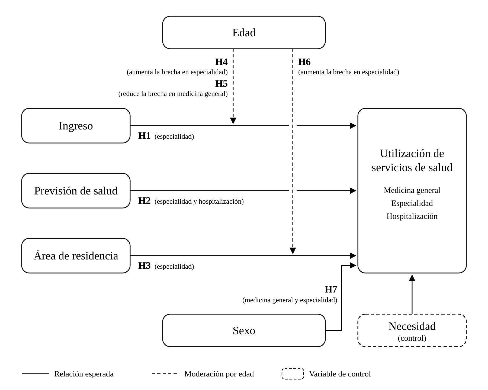

---
title: "Antecedentes empíricos"
---
## Antecedentes empíricos internacionales

La literatura internacional ha documentado la relación entre el estatus socioeconómico y el uso de servicios de salud. En una revisión de carácter comparado, @lantz_socioeconomic_2001 señala que, si bien la disponibilidad y la utilización de la atención de salud dependen de múltiples factores, los indicadores de estatus socioeconómico (ESE), como el ingreso, el nivel educacional y la condición ocupacional, se asocian significativamente con la utilización de servicios en distintos países. Esta relación abarca tanto la cobertura de seguro como el uso de servicios personales: consultas de atención primaria y de especialidad, hospitalizaciones, atención dental y oftalmológica, salud mental, medicamentos con receta y atención domiciliaria [@lantz_socioeconomic_2001].

Con algunas excepciones, la revisión concluye que la mayor parte de los hallazgos empíricos apunta a una asociación positiva: a mayor ESE, mayor utilización de atención de salud, y menores niveles de enfermedad sin tratar y de necesidades médicas insatisfechas. Este patrón se ha observado tanto en hombres como en mujeres, y tanto en población infantil como adulta [@lantz_socioeconomic_2001]. En esa línea, los estratos económicos y educativos más bajos tienden a realizar menos consultas, tanto de atención primaria como de especialidad, a utilizar menos los servicios de salud mental, dental, oftalmológica y preventiva, a contar con menos frecuencia con una fuente habitual de atención y a presentar tasas significativamente mayores de necesidades de salud no cubiertas. En algunos análisis, un ESE más bajo se asocia con un mayor uso de servicios médicos y hospitalarios, especialmente por causas evitables; sin embargo, este patrón parece explicarse principalmente por la mayor prevalencia de mal estado de salud en las poblaciones desfavorecidas [@lantz_socioeconomic_2001].

Respecto de los factores demográficos, la revisión encuentra que las edades extremas y el sexo femenino utilizan más los servicios de salud, efecto que está mediado, al menos en parte, por una mayor necesidad de atención. El tamaño y la estructura familiar también se asocian a la utilización, pero la dirección del efecto depende del país: por ejemplo, en sistemas de acceso universal, los hijos de madres solteras consultan más, mientras que en sistemas con mayores barreras de acceso, este mismo grupo consulta en menor proporción, lo que evidencia la desigualdad [@mendoza-sassi_utilizacion_2001].

El tipo de sistema de salud también modula el efecto del nivel socioeconómico. En países con acceso universal, como Inglaterra o Canadá, las personas de clase baja presentan mejor acceso a los servicios, de modo que el sistema opera como un modificador de efecto que promueve la equidad. En otros contextos, en cambio, los sistemas no logran reducir las desigualdades [@mendoza-sassi_utilizacion_2001].

Por último, entre los factores propios de los servicios de salud, la menor distancia al establecimiento y el mayor número de médicos por habitante aumentan la utilización. En países con una red de servicios adecuada estos factores pierden relevancia, aunque la distancia geográfica puede volver a ser una barrera para grupos específicos, como las personas mayores o quienes tienen alguna limitación funcional [@mendoza-sassi_utilizacion_2001].

## Antecedentes empíricos nacionales

La investigación nacional ha documentado desigualdades en la utilización de servicios de salud en Chile, incluso considerando las diferencias en las necesidades sanitarias de la población. Sin embargo, estas desigualdades no se expresan de igual manera entre los tipos de utilización. Por ello, a continuación se revisa la evidencia empírica nacional sobre el ingreso, la previsión de salud, el territorio, los tipos de utilización, la edad y el sexo. A partir de estos antecedentes, se formulan las hipótesis de investigación, todas referidas a personas con un nivel similar de necesidad percibida.

### Facilitadores individuales: ingreso y previsión de salud 

En relación con las desigualdades socioeconómicas en la utilización de servicios de salud, @nunez_equity_2013 analizaron la utilización y la equidad en el acceso mediante datos de las encuestas CASEN de 1992 a 2009 y de la Encuesta de Satisfacción y Gasto de Bolsillo en Salud de 2006. Sus resultados muestran que, tras ajustar por necesidad, el 20% de mayores ingresos utilizaba servicios médicos casi el doble que el 20% de menores ingresos. En particular, el quintil más pobre registraba una utilización un 7,3% inferior a la esperada según sus necesidades, mientras que en el quintil más rico era un 10,8% superior a lo esperado.

En la misma línea y específicamente en las consultas de especialidad, @vasquez_income-related_2013, con las encuestas CASEN de 2000, 2003 y 2009, consideraron variables como la salud autoevaluada, las limitaciones físicas, la edad y el sexo para distinguir las diferencias de utilización de aquellas asociadas a necesidades sanitarias. Encontraron que las consultas de especialidad presentaban una distribución favorable a los grupos de mayores ingresos, incluso después de ajustar por necesidad, y que la educación y otros factores socioeconómicos contribuyeron a explicar estas desigualdades (pp. 102–103). @paraje_health_2012, con la CASEN 2003 y 2009, también observaron que en ambos años las consultas de especialidad se concentraron en los grupos de mayores ingresos. Por último, Chovar et al. [-@chovarvera_desigualdad_2014] encontraron que las consultas de especialidad favorecieron a los grupos de mayores ingresos. En función de lo anterior, se plantea que:

**H1.** A mayor ingreso, mayor probabilidad de consulta de especialidad.[^hipotesis]

[^hipotesis]: Las hipótesis (H) plantean una relación con una dirección esperada, sustentada en la evidencia previa y en el argumento teórico. Las hipótesis exploratorias (He) se formulan cuando la evidencia disponible no permite anticipar una dirección, por lo que esas relaciones se examinan sin una expectativa definida.

En cuanto a la previsión de salud, @henriquez_desigualdades_2015 con datos de la CASEN 1992, 2000 y 2013, estimaron que una mayor probabilidad de afiliación a Isapre se asociaba con una mayor probabilidad de consulta de especialidad y de hospitalización. Asimismo, @vasquez_income-related_2013 señalan que la afiliación a una Isapre, junto con el nivel educacional, contribuyó a explicar las desigualdades en la atención de especialidad (pp. 102–103). Esto es coherente con un sistema segmentado que distribuye de manera diferenciada las oportunidades de acceso [@bassdelcampo_universalizacion_2025]. Por lo tanto, a partir de esto se plantea:

**H2.** Estar afiliado a Isapre se asocia con mayor probabilidad de consulta de especialidad y de hospitalización o intervención quirúrgica que estar afiliado a Fonasa.

### Facilitadores contextuales

En Chile, la literatura sobre ruralidad se centra en las diferencias de acceso, distancia y distribución de los establecimientos de salud. Según los datos de la CASEN 2022, el 36% de los hogares rurales con personas mayores se encuentra a menos de 2,5 km de un centro de salud, frente al 88,9% de los hogares urbanos [@observatorio_envejecer_2023]. Si bien estos resultados señalan personas con edades avanzadas, ilustran diferencias territoriales en la proximidad de los servicios. A esto se suma la variabilidad geográfica del país, por ejemplo, en la macrozona norte llegar a centros de salud primaria puede tomar entre 57 y 224,3 minutos y para llegar al hospital o clínica más cercana toma entre 92,9 y 484,9 minutos [@observatorio_envejecer_2023]. En este contexto, la desigual distribución de la infraestructura hospitalaria afecta la posibilidad de acceder a atención en salud, especialmente lejos de la zona central del país [@fuenzalida_analisis_2023].

Respecto del uso efectivo de los servicios de salud, la evidencia es menos concluyente. @paraje_health_2012 identificaron que, en 2009, el promedio de consultas de especialidad en zonas rurales fue menos de la mitad del observado en zonas urbanas (0,107 frente a 0,237), mientras que la brecha en medicina general fue menor (0,210 frente a 0,265) (pp. 12–13, tabla 5). En cambio, @henriquez_desigualdades_2015 estimaron que la zona rural no afectaba la probabilidad de consulta general en 1992 y 2000, pero sí en 2013, mientras que en especialidad y urgencia el efecto existía en los años anteriores y desapareció en 2013. Por su parte, con datos de la CASEN 2017, el proyecto NODO [-@nodo_comunidades_2021] informó que el 91,7 % de las personas mayores rurales que reportaron un problema de salud en los últimos tres meses recibió atención médica, frente al 93,3 % de las urbanas, diferencia que no resultó estadísticamente significativa.

Por tanto, aunque la evidencia confirma la relevancia de las barreras territoriales, sus asociaciones con la utilización varían según el servicio y el período estudiado. La diferencia observada en las consultas de especialidad resulta especialmente relevante ya que la oferta de especialistas tiende a concentrarse en los centros urbanos. Sobre esta base se plantea que:

**H3.** Las personas que residen en zonas rurales tienden a presentar menor probabilidad de consulta de especialidad que las que residen en zonas urbanas.

### Medicina general y hospitalización

A diferencia de lo observado en las consultas de especialidad, los resultados sobre medicina general y hospitalización son menos consistentes. @vasquez_income-related_2013 observaron que los resultados variaban según la medida de utilización: a igual necesidad, los grupos de menores ingresos concentraban más días de hospitalización, aunque la probabilidad de hospitalizarse mostraba una distribución ligeramente favorable a los grupos de mayores ingresos (p. 103). @paraje_health_2012 encontraron que la hospitalización presentó una distribución favorable a los grupos de menores ingresos, y que la medicina general pasó de una distribución ligeramente favorable a ellos en 2003 a otra favorable a los de mayores ingresos en 2009 (p. 13). Esto es coherente con la revisión internacional, donde el mayor uso hospitalario de los grupos desfavorecidos se explica principalmente por su peor estado de salud. Como la evidencia no permite anticipar una dirección clara, se exploran:

**He1.** Se explora si el ingreso se relaciona con la consulta de medicina general y con la hospitalización o intervención quirúrgica.

**He2.** Se explora si las diferencias entre zonas urbanas y rurales en la consulta de medicina general y en la hospitalización o intervención quirúrgica son menores que en la consulta de especialidad.

### Edad y sexo

<<<<<<< HEAD

En relación con la edad, Chovar et al.[-@chovarvera_desigualdad_2014] analizaron la utilización de servicios médicos con las encuestas CASEN de 2000, 2003, 2009 y 2011, distinguiendo cuatro grupos etarios, y no identificaron un patrón consistente entre ellos en medicina general ni en días de hospitalización. Por su parte, @henriquez_desigualdades_2015 estimaron que, en los mayores de 66 años, la probabilidad de consulta general y de especialidad fue mayor que en el tramo de 15 a 25 años, mientras que en la hospitalización no encontraron una diferencia significativa entre ambos grupos (p. 17).

=======
En relación con la edad, Chovar et al. [-@chovarvera_desigualdad_2014] analizaron la utilización de servicios médicos con las encuestas CASEN de 2000, 2003, 2009 y 2011, distinguiendo cuatro grupos etarios. En medicina general y días de hospitalización no se identificó un patrón consistente entre grupos etarios. Por su parte, @henriquez_desigualdades_2015 estimaron que, en los mayores de 66 años, la probabilidad de consulta general y de especialidad fue mayor que en el tramo de 15 a 25 años.
>>>>>>> 5a225f1c8f146a213cebde6e26f2c3dd1f137ede

Estos antecedentes muestran que la utilización y su desigualdad varían con la edad, pero no permiten saber si las asociaciones del ingreso, la previsión y el territorio cambian a lo largo de la vida adulta. Desde la ventaja y desventaja acumulada cabría esperar que las diferencias sean mayores en edades avanzadas, porque han tenido más tiempo para acumularse. Sin embargo, estudiar a la población adulta mayor puede subestimar la desigualdad ya que la mortalidad actúa como filtro selectivo en grupos más vulnerables [@ferraro_aging_2009]. La evidencia internacional sugiere, además, que la distancia a los servicios puede ser una barrera particular para las personas mayores o con limitación funcional [@mendoza-sassi_utilizacion_2001]. Siguiendo el argumento central de esta investigación, se espera que la dirección de estas diferencias dependa del tipo de servicio, que crezcan con la edad en la atención de especialidad y que se reduzcan en la medicina general. Además, dado que la necesidad aumenta con la edad y la medicina general es gratuita para los afiliados a Fonasa en la red pública, cabría esperar que en las edades avanzadas su utilización dependa más de la necesidad que de los recursos [@andersen_revisiting_1995; @andersen_national_2008]. En el caso de la previsión de salud, la selección entre ambos seguros y las modificaciones recientes del sector privado no permiten anticipar si sus diferencias aumentan o disminuyen con la edad. Sobre esta base, se plantea:

**H4.** A mayor edad, mayores serán las diferencias por ingreso en la consulta de especialidad, con una mayor utilización entre las personas de mayores ingresos.

**H5.** A mayor edad, menores serán las diferencias por ingreso en la consulta de medicina general.

**H6.** A mayor edad, mayor será la diferencia en la consulta de especialidad entre zonas urbanas y rurales, con una menor utilización en las zonas rurales.

**He3.** Se explora si las diferencias por ingreso en la hospitalización o intervención quirúrgica cambian con la edad.

**He4.** Se explora si las diferencias entre personas afiliadas a Isapre y a Fonasa en la consulta de especialidad cambian con la edad.

Finalmente, la literatura internacional muestra que las mujeres utilizan más los servicios de salud, en parte por una mayor necesidad de atención [@lantz_socioeconomic_2001; @mendoza-sassi_utilizacion_2001], pero no permite anticipar si el ingreso, la previsión y el territorio se relacionan de forma distinta con la utilización en hombres y mujeres. Por ello, se plantean:

**H7.** Las mujeres tienden a presentar mayor probabilidad de consulta de medicina general y de especialidad que los hombres.

**He5.** Se explora si las diferencias por ingreso en la utilización de servicios de salud son distintas entre hombres y mujeres.

**He6.** Se explora si las diferencias entre personas afiliadas a Isapre y a Fonasa en la utilización de servicios de salud son distintas entre hombres y mujeres.

**He7.** Se explora si las diferencias entre zonas urbanas y rurales en la utilización de servicios de salud son distintas entre hombres y mujeres.

## Diagrama de hipótesis 

La @fig-hipotesis resume las hipótesis con dirección esperada.

{#fig-hipotesis width=95%}

*Nota.* Las hipótesis H2, H3 y H7 plantean una mayor utilización entre las personas afiliadas a Isapre, residentes en zonas urbanas y mujeres, respectivamente. Las hipótesis exploratorias (He1 a He7) se presentan en el texto.